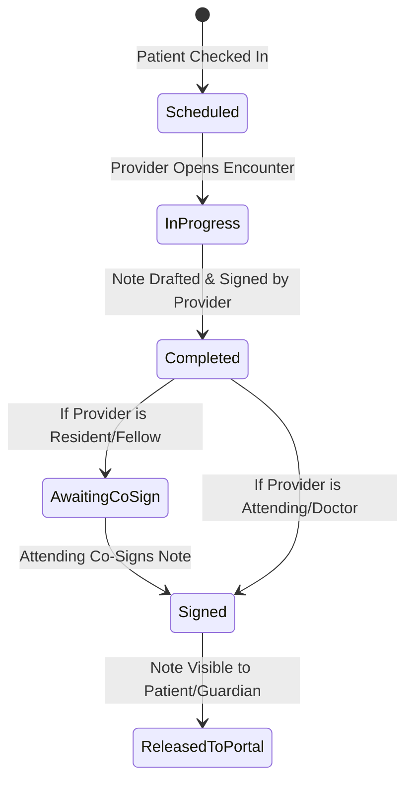

# Module 03: Clinical Encounters & Charting

## 1. Executive Overview

The Clinical Encounters & Charting module is the core documentation engine of Bloom EMR. It provides clinicians with a rapid, structured environment for recording patient visits, managing clinical observations, formatting multi-disciplinary progress notes, and finalizing legal health records.

Key capabilities:
- **Multiple Note Formats**: Built-in support for SOAP (Subjective, Objective, Assessment, Plan), DAP (Data, Assessment, Plan), and specialized Comprehensive Psychiatric Intake templates.
- **SmartPhrases Engine**: Dot/at-syntax trigger expansion (`@phrase` / `.phrase`) with real-time autocompletion to accelerate documentation.
- **Academic Medical Center Supervised Workflow**: Automated co-signing pipeline for residents and fellows supervised by attending physicians.
- **Encounter Lifecycle Management**: Structured states from `scheduled` and `in_progress` to `signed` and `locked` with release controls for the Patient Portal.

---

## 2. Personas & Clinical Workflow

### The Encounter Lifecycle


### Roles & Responsibilities
- **Attending Physician / Doctor**: Initiates encounters, drafts notes, signs and locks notes, reviews and co-signs resident notes.
- **Resident / Fellow**: Initiates encounters and drafts notes; signing marks the encounter as `awaiting_cosign` and assigns an attending supervisor.
- **Nurse / Clinical Staff**: Documents vitals, chief complaint, and initial triage observations prior to provider examination.

---

## 3. Database Architecture & Schema

### 1. [Encounter](file:///c:/Users/User/Herd/bloom/app/Models/Encounter.php)
- **Table**: `encounters`
- **Traits**: [BelongsToPractice](file:///c:/Users/User/Herd/bloom/app/Models/Concerns/BelongsToPractice.php), `HasFactory`, `SoftDeletes`

| Column | Type | Description |
| :--- | :--- | :--- |
| `id` | `bigint unsigned` | Primary key |
| `practice_id` | `foreignId` | Multi-tenant practice reference |
| `patient_id` | `foreignId` | Patient being evaluated |
| `provider_id` | `foreignId` | Primary clinician conducting the visit |
| `cosigning_provider_id` | `foreignId nullable` | Attending physician responsible for co-sign |
| `encounter_date` | `dateTime` | Date and time of visit |
| `encounter_type` | `string` | e.g., `office_visit`, `telehealth`, `initial_intake`, `follow_up` |
| `status` | `string` | `scheduled`, `in_progress`, `completed`, `awaiting_cosign`, `signed`, `cancelled` |
| `reason_for_visit` | `string` | Patient chief complaint |
| `diagnoses` | `json` | Structured ICD-10 diagnostic codes attached to encounter |
| `billing_codes` | `json` | CPT / E&M evaluation codes for billing generation |
| `released_to_portal_at` | `dateTime nullable` | Release timestamp for patient portal visibility |

### 2. [ClinicalNote](file:///c:/Users/User/Herd/bloom/app/Models/ClinicalNote.php)
- **Table**: `clinical_notes`

| Column | Type | Description |
| :--- | :--- | :--- |
| `encounter_id` | `foreignId` | Associated encounter |
| `template_type` | `string` | `SOAP`, `DAP`, `Intake`, `Freeform` |
| `note_content` | `json` | Structured content payload (e.g., `{subjective: '...', objective: '...', assessment: '...', plan: '...'}`) |
| `is_signed` | `boolean` | Indicates provider signature status |
| `signed_at` | `dateTime nullable` | Signature timestamp |
| `cosigned_at` | `dateTime nullable` | Attending co-signature timestamp |

### 3. [SmartPhrase](file:///c:/Users/User/Herd/bloom/app/Models/SmartPhrase.php)
- **Table**: `smart_phrases`

| Column | Type | Description |
| :--- | :--- | :--- |
| `trigger` | `string` | Abbreviation starting with `@` or `.` (e.g., `@mse`, `.phq9neg`) |
| `expansion` | `text` | Expanded macro template text |
| `category` | `string` | Classification (e.g., `psychiatry`, `pediatrics`, `general`) |
| `is_global` | `boolean` | Whether phrase is available practice-wide |
| `owner_id` | `foreignId nullable` | Creator provider (private phrases) |

---

## 4. SmartPhrases & Autocompletion Engine

SmartPhrases allow clinicians to inject complex clinical templates (e.g., Mental Status Exam, normal physical exam findings, standard discharge instructions) with a single keystroke.

### Autocompletion Endpoint: `GET /api/smart-phrases?q={prefix}`
Configured in [routes/web.php](file:///c:/Users/User/Herd/bloom/routes/web.php#L157-L174):
```php
Route::get('api/smart-phrases', function (Request $request) {
    $q = $request->query('q');
    if (empty($q)) return response()->json([]);

    return SmartPhrase::query()
        ->where('trigger', 'like', $q.'%')
        ->where(function ($query) {
            $query->where('is_global', true)
                ->orWhere('owner_id', auth()->id());
        })
        ->limit(10)
        ->get(['id', 'trigger', 'expansion', 'category']);
});
```
Clinicians typing `@` in any clinical textarea trigger an Alpine.js/Tribute dropdown matching active smart phrases. Selecting a phrase immediately substitutes the trigger with the full expansion text.

---

## 5. UI Components & Layouts

- [EncounterList](file:///c:/Users/User/Herd/bloom/app/Livewire/Encounters/EncounterList.php):
  - Filters by provider, date range, encounter type, and signing status.
  - Highlights encounters pending co-signature for supervising attendings.
- [EncounterForm](file:///c:/Users/User/Herd/bloom/app/Livewire/Encounters/EncounterForm.php):
  - Manages visit intake, vitals recording, and reason for visit.
- [EncounterNote](file:///c:/Users/User/Herd/bloom/app/Livewire/Encounters/EncounterNote.php):
  - The primary charting interface.
  - Multi-tabbed template selector (SOAP vs. DAP vs. Psychiatric Intake).
  - Integrated AI clinical assistant sidebar for instant transcript drafting.
  - Signature and co-signature confirmation dialogs.

---

## 6. Testing & Quality Assurance

- [ClinicalNoteTest](file:///c:/Users/User/Herd/bloom/tests/Feature/ClinicalNoteTest.php):
  - Verifies note creation, template JSON structure, and signing restrictions.
  - Asserts that residents cannot sign off independently without placing the encounter in `awaiting_cosign`.
  - Verifies attending co-signature transitions status to `signed`.
- [SmartPhrasesTest](file:///c:/Users/User/Herd/bloom/tests/Feature/SmartPhrasesTest.php):
  - Tests global vs. private phrase scoping.
  - Validates fast prefix search via the `/api/smart-phrases` API.
