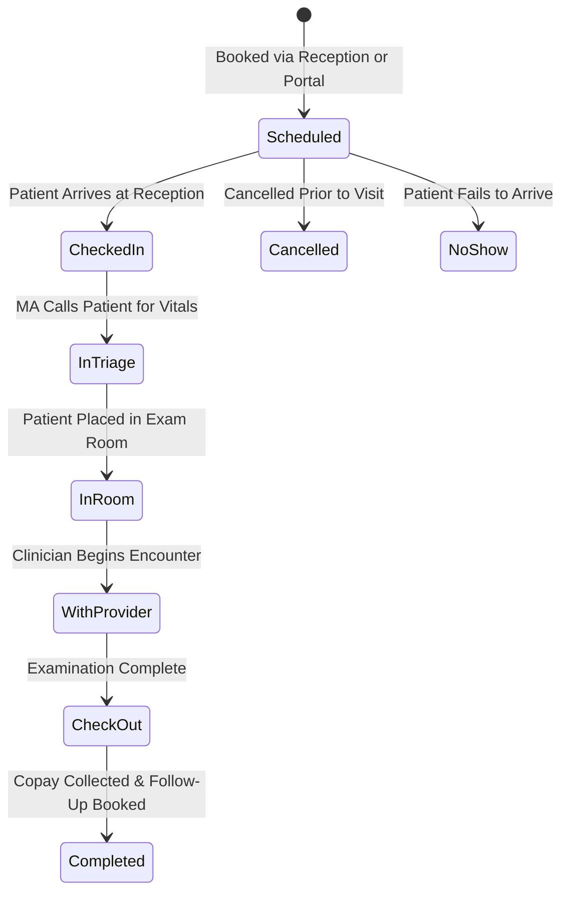

# Module 06: Scheduling & Patient Flow Board

## 1. Executive Overview

The Scheduling & Patient Flow Board module coordinates physical and virtual patient movement across the healthcare facility. It pairs a provider calendar with an interactive, Kanban-style real-time Flow Board that tracks patients from arrival through triage, examination, and checkout.

Key capabilities:
- **Comprehensive Provider Calendar**: Day, week, and month scheduling views with multi-provider filtering and conflict detection.
- **Visual Clinic Flow Board**: Real-time tracking of patient status (`checked_in`, `triage`, `in_room`, `with_provider`, `checkout`, `completed`).
- **Wait Time & Bottleneck Tracking**: Monitors room occupancy times and clinic wait times to optimize patient throughput.
- **Bi-Directional Portal Booking**: Patients and guardians can request or directly book available slots via the Patient Portal.
- **Telehealth Link Generation**: Automatically generates virtual consultation links for appointments designated as telehealth.

---

## 2. Clinic Flow Lifecycle

---

## 3. Database Architecture & Schema

### Primary Model: [Appointment](file:///c:/Users/User/Herd/bloom/app/Models/Appointment.php)
- **Table**: `appointments`
- **Traits**: [BelongsToPractice](file:///c:/Users/User/Herd/bloom/app/Models/Concerns/BelongsToPractice.php), `HasFactory`

| Column | Type | Description |
| :--- | :--- | :--- |
| `id` | `bigint unsigned` | Primary key |
| `practice_id` | `foreignId` | Multi-tenant practice reference |
| `patient_id` | `foreignId` | Patient being scheduled |
| `provider_id` | `foreignId` | Target clinician |
| `facility_id` | `foreignId nullable` | Target clinic facility/branch |
| `appointment_date` | `dateTime` | Scheduled start timestamp |
| `duration_minutes`| `integer` | Appointment duration (default: 30) |
| `type` | `string` | `initial_intake`, `follow_up`, `med_management`, `telehealth` |
| `status` | `string` | `scheduled`, `checked_in`, `in_room`, `with_provider`, `completed`, `cancelled`, `no_show` |
| `exam_room` | `string nullable` | Assigned exam room (e.g., `'Room 102'`) |
| `reason` | `string` | Reason for visit |
| `notes` | `text nullable` | Administrative or clinical prep notes |
| `checked_in_at` | `dateTime nullable` | Arrival timestamp |
| `seen_at` | `dateTime nullable` | Provider entrance timestamp |
| `completed_at` | `dateTime nullable` | Checkout timestamp |

---

## 4. UI Components & Layouts

### 1. Appointment Management: [AppointmentList](file:///c:/Users/User/Herd/bloom/app/Livewire/Scheduling/AppointmentList.php)
- Multi-provider schedule view with date navigation controls.
- Modal for booking appointments with patient autocompletion, type selection, and duration configuration.
- Quick cancellation and rescheduling actions with notification dispatches.

### 2. Clinic Flow Board: [FlowBoard](file:///c:/Users/User/Herd/bloom/app/Livewire/Scheduling/FlowBoard.php)
A real-time status board modeled after modern hospital throughput systems:
- **Columns**:
  1. *Waiting Room* (Checked In)
  2. *Triage / Vitals*
  3. *Ready for Provider* (In Room)
  4. *With Clinician* (Active Encounter)
  5. *Check-Out / Billing*
- **Live Elapsed Time Badges**: Visual warnings for patients waiting more than 15 minutes in any single stage.
- **One-Click Transitions**: Clinicians and MAs can update patient room assignments and move cards between stages with instant Livewire reactivity.
- **Direct Chart Access**: Clicking any patient card provides direct jump links into the active [EncounterNote](file:///c:/Users/User/Herd/bloom/app/Livewire/Encounters/EncounterNote.php).

### 3. Patient Portal Booking: [PortalAppointments](file:///c:/Users/User/Herd/bloom/app/Livewire/Portal/PortalAppointments.php)
- Self-service appointment scheduling for patients and guardians.
- Displays upcoming confirmed visits and past appointment history.

---

## 5. Telehealth Coordination

When an appointment is designated as `type = 'telehealth'`:
1. The appointment record automatically generates a secure Daily.co video room token via [DailyService](file:///c:/Users/User/Herd/bloom/app/Services/DailyService.php).
2. The patient receives a portal notification and email with a secure join link.
3. The provider can launch the video interface directly from the Flow Board or encounter chart.

---

## 6. Testing & Quality Assurance

- [SchedulingTest](file:///c:/Users/User/Herd/bloom/tests/Feature/SchedulingTest.php):
  - Validates appointment creation, validation rules, and provider conflict detection.
  - Tests state transitions across the Flow Board (`checked_in` $\rightarrow$ `in_room` $\rightarrow$ `completed`).
  - Verifies multi-tenant isolation across practice appointment books.
