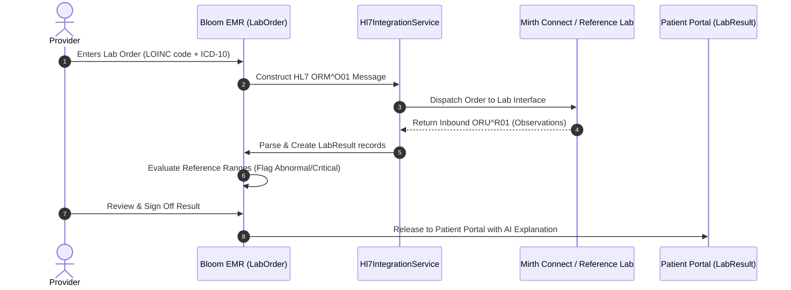

# Module 07: Diagnostic Laboratory Management

## 1. Executive Overview

The Diagnostic Laboratory Management module manages the end-to-end laboratory testing lifecycle. From initial provider electronic order requisition to HL7 interface communication, specimen tracking, and quantitative result interpretation with critical value alerting, the module streamlines lab operations for both in-house hospital labs and external commercial reference laboratories (e.g., Quest Diagnostics, Labcorp).

Key capabilities:
- **Electronic Lab Orders (CPOE)**: Computerized Provider Order Entry with ICD-10 diagnostic justification.
- **HL7 v2.x Standards Compliance**: Generates outbound HL7 `ORM^O01` order messages and parses inbound `ORU^R01` observation results.
- **Abnormal & Critical Value Highlighting**: Automatic flagging of results outside biological reference ranges with high/low/panic alerts.
- **Portal Result Release**: Controlled release mechanism allowing providers to review and annotate results before they appear on the Patient Portal.
- **Interface Engine Integration**: Direct connectivity with [MirthConnectService](file:///c:/Users/User/Herd/bloom/app/Services/MirthConnectService.php) and commercial clearinghouses (Health Gorilla).

---

## 2. Lab Lifecycle & Message Flow

---

## 3. Database Architecture & Schema

### 1. [LabOrder](file:///c:/Users/User/Herd/bloom/app/Models/LabOrder.php)
- **Table**: `lab_orders`
- **Traits**: [BelongsToPractice](file:///c:/Users/User/Herd/bloom/app/Models/Concerns/BelongsToPractice.php), `HasFactory`

| Column | Type | Description |
| :--- | :--- | :--- |
| `id` | `bigint unsigned` | Primary key |
| `practice_id` | `foreignId` | Multi-tenant practice reference |
| `patient_id` | `foreignId` | Patient being tested |
| `encounter_id` | `foreignId nullable` | Linked encounter |
| `ordering_provider_id`| `foreignId` | Clinician ordering the test |
| `test_name` | `string` | e.g., `'Comprehensive Metabolic Panel (CMP)'`, `'Lithium Level'` |
| `loinc_code` | `string nullable` | Universal LOINC identifier (e.g., `'24323-8'`) |
| `status` | `string` | `ordered`, `collected`, `in_process`, `completed`, `cancelled` |
| `priority` | `string` | `routine`, `stat`, `urgent` |
| `diagnosis_code`| `string nullable` | Justifying ICD-10 code |
| `ordered_at` | `dateTime` | Timestamp of order creation |

### 2. [LabResult](file:///c:/Users/User/Herd/bloom/app/Models/LabResult.php)
- **Table**: `lab_results`

| Column | Type | Description |
| :--- | :--- | :--- |
| `lab_order_id` | `foreignId` | Parent lab order reference |
| `patient_id` | `foreignId` | Patient reference |
| `test_component`| `string` | Component name (e.g., `'Serum Potassium'`, `'WBC'`) |
| `value` | `string` | Quantitative or qualitative result |
| `units` | `string` | Measurement unit (e.g., `'mEq/L'`, `'mg/dL'`) |
| `reference_range`| `string` | Normal biological interval (e.g., `'3.5 - 5.0'`) |
| `abnormal_flag` | `string nullable` | `normal`, `high`, `low`, `abnormal`, `critical` |
| `result_status` | `string` | `preliminary`, `final`, `corrected` |
| `resulted_at` | `dateTime` | Result reporting timestamp |
| `released_to_portal`| `boolean` | Patient portal visibility status |

---

## 4. Integration Services

### 1. [Hl7IntegrationService](file:///c:/Users/User/Herd/bloom/app/Services/Hl7IntegrationService.php)
- **HL7 Generation**: `generateMockQuestHl7(Patient $patient, LabOrder $order, array $observations)` creates valid HL7 v2.3/v2.5 pipe-and-hat (`|`, `^`) formatted observation reports (MSH, PID, OBR, OBX segments).
- **HL7 Parser**: Ingests raw HL7 strings, tokenizes segments, and persists structured [LabResult](file:///c:/Users/User/Herd/bloom/app/Models/LabResult.php) rows.
- **Reference Range Evaluation**: Compares numeric results against range delimiters and tags abnormal flags (`H` for high, `L` for low, `C` for critical/panic).

### 2. [MirthConnectService](file:///c:/Users/User/Herd/bloom/app/Services/MirthConnectService.php)
- Interfaces with local or cloud-hosted Mirth Connect channels over TCP/LLP (Lower Layer Protocol) or HTTPS REST for transmission to external hospital LIS systems.

---

## 5. UI Components & Layouts

- [PatientLabs](file:///c:/Users/User/Herd/bloom/app/Livewire/Patients/PatientLabs.php):
  - Embedded inside the patient master chart.
  - Displays all historic lab orders and component results in an expandable accordion.
  - Visual badges for `Critical` (red alert badge), `High` (amber), and `Normal` (green).
  - One-click modal to create new lab requisitions.
- [PortalLabs](file:///c:/Users/User/Herd/bloom/app/Livewire/Portal/PortalLabs.php):
  - Patient portal lab viewer.
  - Only displays results with `released_to_portal = true`.
  - Integrates AI plain-language summaries generated by [AiClinicalAssistantService](file:///c:/Users/User/Herd/bloom/app/Services/AiClinicalAssistantService.php) to help patients understand complex medical metrics.

---

## 6. Testing & Quality Assurance

- [LabManagementTest](file:///c:/Users/User/Herd/bloom/tests/Feature/LabManagementTest.php):
  - Tests lab order requisition creation and validation.
  - Validates HL7 parser segment extraction and persistence of component results.
  - Verifies abnormal flag detection and patient portal access filters.
