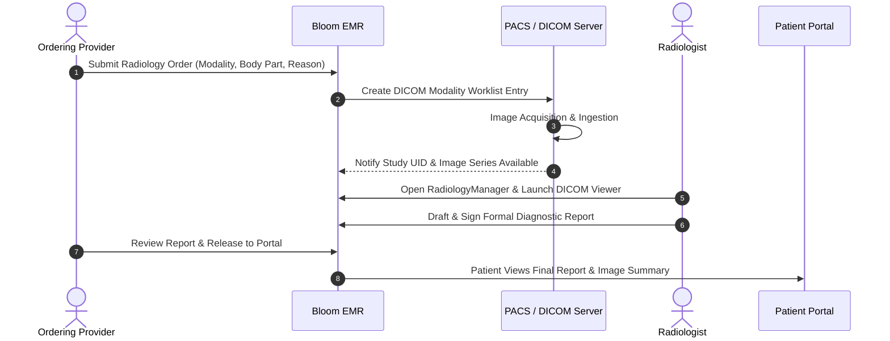

# Module 08: Radiology, Medical Imaging & PACS

## 1. Executive Overview

The Radiology & Medical Imaging module delivers end-to-end management of diagnostic imaging requisitions, Picture Archiving and Communication System (PACS) interoperability, DICOM web viewing, and radiologist diagnostic reporting.

Key capabilities:
- **Computerized Imaging Requisitions**: Orders covering X-Ray, CT, MRI, Ultrasound, and PET with ICD-10 justification and contrast safety checklists.
- **DICOM Web & PACS Integration**: Full support for DICOM WADO-RS (Web Access to DICOM Objects) and QIDO-RS (Query based on ID for DICOM Objects) via [DicomImagingService](file:///c:/Users/User/Herd/bloom/app/Services/DicomImagingService.php).
- **Embedded Web DICOM Viewer**: Launches zero-footprint web viewing sessions directly within the clinician's browser.
- **Structured Radiologist Reporting**: Diagnostic reports featuring findings, impressions, and recommendations with multi-step signature verification.
- **Controlled Portal Access**: Secure image review and formal report downloads for patients on the portal once released by the ordering clinician.

---

## 2. Imaging Workflow

---

## 3. Database Architecture & Schema

### 1. [RadiologyOrder](file:///c:/Users/User/Herd/bloom/app/Models/RadiologyOrder.php)
- **Table**: `radiology_orders`
- **Traits**: [BelongsToPractice](file:///c:/Users/User/Herd/bloom/app/Models/Concerns/BelongsToPractice.php), `HasFactory`

| Column | Type | Description |
| :--- | :--- | :--- |
| `id` | `bigint unsigned` | Primary key |
| `practice_id` | `foreignId` | Multi-tenant practice reference |
| `patient_id` | `foreignId` | Target patient |
| `encounter_id` | `foreignId nullable` | Associated clinical encounter |
| `ordering_provider_id`| `foreignId` | Clinician ordering the exam |
| `modality` | `string` | `xray`, `ct`, `mri`, `ultrasound`, `pet` |
| `body_part` | `string` | e.g., `'Chest'`, `'Brain'`, `'Left Knee'` |
| `reason_for_study`| `text` | Clinical justification and symptoms |
| `priority` | `string` | `routine`, `urgent`, `stat` |
| `status` | `string` | `ordered`, `scheduled`, `in_progress`, `completed`, `cancelled` |
| `dicom_study_uid` | `string nullable` | Unique DICOM Study Instance UID |
| `accession_number`| `string nullable` | Unique departmental identifier |

### 2. [RadiologyReport](file:///c:/Users/User/Herd/bloom/app/Models/RadiologyReport.php)
- **Table**: `radiology_reports`

| Column | Type | Description |
| :--- | :--- | :--- |
| `radiology_order_id` | `foreignId` | Associated radiology order |
| `radiologist_id` | `foreignId` | Interpreting radiologist |
| `findings` | `text` | Detailed anatomical and pathological observations |
| `impression` | `text` | Diagnostic conclusion |
| `recommendations` | `text nullable` | Suggested follow-up studies |
| `status` | `string` | `preliminary`, `final`, `addended` |
| `signed_at` | `dateTime nullable` | Radiologist digital signature timestamp |
| `released_to_portal` | `boolean` | Patient visibility flag |

---

## 4. PACS & DICOM Service: [DicomImagingService](file:///c:/Users/User/Herd/bloom/app/Services/DicomImagingService.php)

The imaging service interfaces between Bloom EMR and external or cloud PACS servers (e.g., Orthanc, dcm4chee, AWS HealthImaging):
- **Study Query**: `getStudyMetadata(string $studyUid)` retrieves series counts, modalities, instance counts, and acquisition parameters.
- **Viewer URL Generation**: `getViewerUrl(string $studyUid)` generates signed, time-limited tokens to embed interactive zero-footprint DICOM viewers (Cornerstone.js / OHIF Viewer).
- **PACS Health Check**: Validates connectivity and DICOM Echo (C-ECHO) status to the imaging archive.

---

## 5. UI Components & Layouts

- [RadiologyManager](file:///c:/Users/User/Herd/bloom/app/Livewire/Radiology/RadiologyManager.php):
  - Departmental workstation for radiologists and imaging technologists.
  - Worklist filters by modality, status, priority, and date.
  - Split-screen workspace allowing simultaneous viewing of the diagnostic report editor and the PACS study viewer.
- [PatientRadiology](file:///c:/Users/User/Herd/bloom/app/Livewire/Patients/PatientRadiology.php):
  - Embedded tab inside the patient's master chart.
  - Timeline of all historic imaging studies with direct links to view full reports and launch imaging viewers.
- [PortalRadiology](file:///c:/Users/User/Herd/bloom/app/Livewire/Portal/PortalRadiology.php):
  - Patient portal imaging view showing completed reports released by the care team.

---

## 6. Testing & Quality Assurance

- [RadiologyTest](file:///c:/Users/User/Herd/bloom/tests/Feature/RadiologyTest.php):
  - Tests ordering workflows and modality validation.
  - Validates radiologist report sign-off and state transition to `completed`.
  - Verifies DICOM Study UID generation and linking.
- [RadiologyManagementTest](file:///c:/Users/User/Herd/bloom/tests/Feature/RadiologyManagementTest.php):
  - Tests departmental worklist filtering and patient chart integration.
