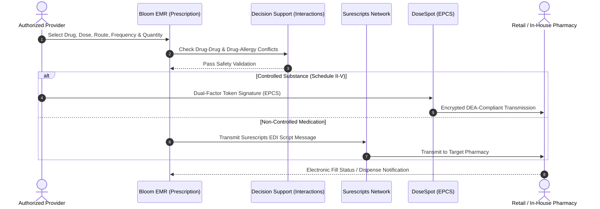

# Module 09: E-Prescribing & Medication Management

## 1. Executive Overview

The E-Prescribing & Medication Management module provides electronic prescription routing, formulary checking, external medication history reconciliation, and controlled substance management. Built to conform with national e-prescribing standards (Surescripts) and federal/state regulations (DEA EPCS and New York State I-STOP mandates), the module secures the medication lifecycle from clinical ordering to pharmacy fulfillment.

Key capabilities:
- **Electronic Prescription Transmission**: Direct electronic routing of prescriptions to retail, mail-order, and hospital pharmacies via [SurescriptsService](file:///c:/Users/User/Herd/bloom/app/Services/SurescriptsService.php).
- **Electronic Prescriptions for Controlled Substances (EPCS)**: Certified EPCS workflows with two-factor cryptographic provider authentication via [DoseSpotService](file:///c:/Users/User/Herd/bloom/app/Services/DoseSpotService.php).
- **Real-Time Formulary & Benefit Checks**: Informs clinicians of insurance copays, tier status, and prior authorization requirements before transmission.
- **Medication History Retrieval**: Automatically pulls 12-month external dispense records from PBMs to reconcile medication charts upon intake.
- **Medication Teaching Logs**: Documents patient and guardian education regarding dosing, adverse effects, and compliance via [MedicationTeachingLog](file:///c:/Users/User/Herd/bloom/app/Models/MedicationTeachingLog.php).

---

## 2. E-Prescribing Pipeline

---

## 3. Database Architecture & Schema

### 1. [Prescription](file:///c:/Users/User/Herd/bloom/app/Models/Prescription.php)
- **Table**: `prescriptions`
- **Traits**: [BelongsToPractice](file:///c:/Users/User/Herd/bloom/app/Models/Concerns/BelongsToPractice.php), `HasFactory`

| Column | Type | Description |
| :--- | :--- | :--- |
| `id` | `bigint unsigned` | Primary key |
| `practice_id` | `foreignId` | Multi-tenant practice reference |
| `patient_id` | `foreignId` | Target patient |
| `provider_id` | `foreignId` | Prescribing provider |
| `pharmacy_id` | `foreignId nullable` | Target community or in-house pharmacy |
| `medication_name` | `string` | Generic and brand medication name |
| `dosage` | `string` | e.g., `'20mg'`, `'5ml'` |
| `route` | `string` | `oral`, `intramuscular`, `sublingual`, `transdermal` |
| `frequency` | `string` | e.g., `'Once daily in the morning'` |
| `quantity` | `integer` | Total dispense amount |
| `refills` | `integer` | Number of authorized refills |
| `is_controlled` | `boolean` | Flag for DEA Schedule II–V drugs |
| `dea_schedule` | `string nullable` | Schedule designation (`'C-II'`, `'C-IV'`) |
| `status` | `string` | `active`, `transmitted`, `filled`, `discontinued`, `expired` |
| `fulfillment_status`| `string` | `pending`, `ready_for_pickup`, `dispensed` |
| `transmitted_at` | `dateTime nullable` | Transmission timestamp |

### 2. [RefillRequest](file:///c:/Users/User/Herd/bloom/app/Models/RefillRequest.php)
- **Table**: `refill_requests`

| Column | Type | Description |
| :--- | :--- | :--- |
| `prescription_id` | `foreignId` | Target active prescription |
| `patient_id` | `foreignId` | Requesting patient |
| `requested_refills`| `integer` | Desired refill quantity |
| `status` | `string` | `pending`, `approved`, `denied` |
| `notes` | `text nullable` | Patient message or provider denial rationale |
| `responded_at` | `dateTime nullable` | Provider decision timestamp |

---

## 4. Integration Services

### 1. [SurescriptsService](file:///c:/Users/User/Herd/bloom/app/Services/SurescriptsService.php)
- `checkFormulary(Patient $patient, string $drugName)`: Queries active payer formulary tiers and prior authorization flags.
- `transmitPrescription(Prescription $prescription)`: Serializes prescription into Surescripts SCRIPT standard XML/EDI and transmits to NCPDP network.
- `fetchExternalMedHistory(Patient $patient)`: Ingests 12-month community dispense history for reconciliation.
- Includes built-in mock drivers (`mockCheckFormulary`, `mockTransmitPrescription`, `mockFetchExternalMedHistory`) for sandbox environments.

### 2. [DoseSpotService](file:///c:/Users/User/Herd/bloom/app/Services/DoseSpotService.php)
- Handles SSO launch into DoseSpot's EPCS certified prescribing UI.
- Validates DEA credentials and tokenized approvals for controlled substances.

---

## 5. UI Components & Layouts

- [PatientMedications](file:///c:/Users/User/Herd/bloom/app/Livewire/Patients/PatientMedications.php):
  - Primary charting view of active and discontinued medications.
  - Interactive modal to write new prescriptions with autocomplete for common dosing regimens.
  - One-click discontinuation and adverse reaction logging.
- [PatientRefills](file:///c:/Users/User/Herd/bloom/app/Livewire/Patients/PatientRefills.php):
  - Provider inbox for managing inbound patient refill requests.
  - One-click approval or denial with clinical comments.
- [PortalRefills](file:///c:/Users/User/Herd/bloom/app/Livewire/Portal/PortalRefills.php):
  - Patient portal view where patients and guardians can request refills on existing active prescriptions.

---

## 6. Testing & Quality Assurance

- [MedicationPrescribingTest](file:///c:/Users/User/Herd/bloom/tests/Feature/MedicationPrescribingTest.php):
  - Validates prescription creation, dosing constraints, and provider authorization gates.
  - Asserts that non-prescribing roles (e.g., nurses, front desk) are prevented from signing prescriptions.
  - Verifies Surescripts electronic routing and transmission logging.
- [PortalRefillsTest](file:///c:/Users/User/Herd/bloom/tests/Feature/PortalRefillsTest.php):
  - Tests portal refill request submission and provider approval cycles.
