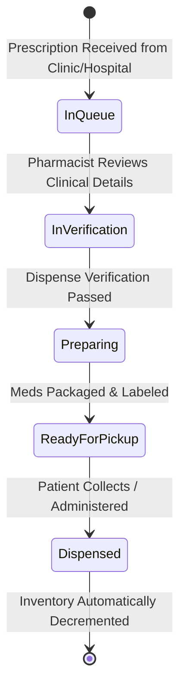

# Module 10: Pharmacy Portal & Inventory Management

## 1. Executive Overview

The Pharmacy Portal & Inventory Management module provides dedicated operations for hospital pharmacies, in-house dispensing clinics, and affiliated retail pharmacies. It features a specialized pharmacist interface for verifying, preparing, and dispensing prescriptions, paired with real-time stock control tracking lot numbers, expiration dates, and automated reorder alerts.

Key capabilities:
- **Dedicated Pharmacist Workstation**: Streamlined queue for incoming prescriptions routed from hospital clinicians or community providers.
- **Dispensing & Verification Workflow**: Multi-step safety checks confirming drug, dosage, quantity, and patient identity before marking prescriptions ready for pickup.
- **Pharmaceutical Inventory Control**: Real-time tracking of National Drug Codes (NDCs), unit on-hand balances, and minimum reorder thresholds via [InventoryService](file:///c:/Users/User/Herd/bloom/app/Services/InventoryService.php).
- **Lot & Expiration Tracking**: Enforces strict First-Expired, First-Out (FEFO) dispensing and alerts staff to impending drug expirations.
- **Dedicated Practice Routing**: Users with the `pharmacist` role or assigned to a `type = 'pharmacy'` practice are automatically routed to the specialized [PharmacyPortal](file:///c:/Users/User/Herd/bloom/app/Livewire/Pharmacy/PharmacyPortal.php).

---

## 2. Pharmacy Dispensing Lifecycle

---

## 3. Database Architecture & Schema

### 1. [Pharmacy](file:///c:/Users/User/Herd/bloom/app/Models/Pharmacy.php)
- **Table**: `pharmacies`
- **Traits**: [BelongsToPractice](file:///c:/Users/User/Herd/bloom/app/Models/Concerns/BelongsToPractice.php), `HasFactory`

| Column | Type | Description |
| :--- | :--- | :--- |
| `id` | `bigint unsigned` | Primary key |
| `practice_id` | `foreignId` | Associated practice tenant |
| `name` | `string` | Pharmacy name |
| `npi` / `ncpdp_id` | `string nullable` | National Provider Identifier & NCPDP identifier |
| `phone` / `fax` / `email`| `string` | Communication coordinates |
| `address` | `text` | Physical dispensing address |
| `is_in_house` | `boolean` | Flag distinguishing internal vs. external retail pharmacies |

### 2. [InventoryItem](file:///c:/Users/User/Herd/bloom/app/Models/InventoryItem.php)
- **Table**: `inventory_items`
- **Traits**: [BelongsToPractice](file:///c:/Users/User/Herd/bloom/app/Models/Concerns/BelongsToPractice.php), `HasFactory`

| Column | Type | Description |
| :--- | :--- | :--- |
| `id` | `bigint unsigned` | Primary key |
| `practice_id` | `foreignId` | Associated practice |
| `name` | `string` | Drug/Item description |
| `ndc` | `string nullable` | National Drug Code |
| `lot_number` | `string` | Batch / lot identifier |
| `expiration_date`| `date` | Expiration date |
| `quantity_on_hand`| `integer` | Available unit inventory |
| `reorder_threshold`| `integer` | Minimum stock trigger level |
| `unit_cost` | `decimal` | Unit acquisition cost |

---

## 4. Backend Service: [InventoryService](file:///c:/Users/User/Herd/bloom/app/Services/InventoryService.php)

- `decrementStock(int $itemId, int $quantity)`: Atomically decrements quantity upon dispensing and creates audit log entries.
- `checkLowStockAlerts(int $practiceId)`: Scans all items where `quantity_on_hand <= reorder_threshold` and dispatches notifications to pharmacy admins.
- `checkExpiringStock(int $practiceId, int $daysThreshold = 30)`: Identifies lots expiring within the specified window to prevent dispensing expired products.

---

## 5. UI Components & Layouts

### 1. [PharmacyPortal](file:///c:/Users/User/Herd/bloom/app/Livewire/Pharmacy/PharmacyPortal.php)
- Live queue of active prescriptions awaiting verification or dispensing.
- Filters by status (`pending`, `verified`, `ready_for_pickup`, `dispensed`).
- Detailed verification modal displaying patient allergies, concurrent medications, and prescribing provider contact.
- One-click dispensing action that automatically deducts stock from inventory and updates the [Prescription](file:///c:/Users/User/Herd/bloom/app/Models/Prescription.php) record.

### 2. [InventoryManager](file:///c:/Users/User/Herd/bloom/app/Livewire/InventoryManager.php)
- Table view of all pharmaceuticals, consumables, and clinical supplies.
- Search by NDC, lot number, or brand/generic name.
- Visual alerts:
  - Red badge for items at zero or below reorder threshold.
  - Amber warning for items expiring within 30 days.
- Stock adjustment modal for recording new shipments, returns, and write-offs.

---

## 6. Testing & Quality Assurance

- [PharmacyPortalTest](file:///c:/Users/User/Herd/bloom/tests/Feature/PharmacyPortalTest.php):
  - Tests prescription queue loading, status updates, and dispensing actions.
  - Verifies automatic inventory deduction upon dispense completion.
- [PharmacistAuthRedirectTest](file:///c:/Users/User/Herd/bloom/tests/Feature/PharmacistAuthRedirectTest.php):
  - Confirms users with the `pharmacist` role are redirected to `/pharmacy/portal` upon authentication.
- [PharmacySettingsTest](file:///c:/Users/User/Herd/bloom/tests/Feature/PharmacySettingsTest.php):
  - Tests pharmacy location configuration and NCPDP identity storage.
