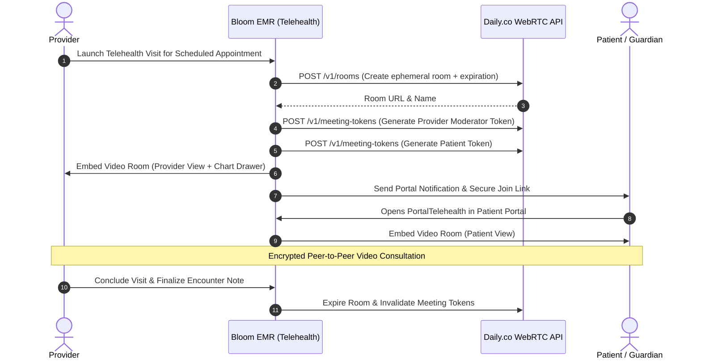

# Module 12: Telemedicine & Virtual Care

## 1. Executive Overview

The Telemedicine & Virtual Care module delivers browser-based, encrypted audio-video consultations embedded directly within Bloom EMR. Powered by the Daily.co WebRTC infrastructure, the module enables providers to conduct virtual patient evaluations while maintaining live, side-by-side access to the clinical chart and active encounter documentation.

Key capabilities:
- **Zero-Install WebRTC Video**: Patients and providers join encrypted video rooms directly in modern desktop and mobile browsers without third-party app downloads.
- **HIPAA-Compliant Rooms**: Ephemeral, private video rooms (`is_private: true`) generated dynamically per encounter with cryptographically signed meeting tokens via [DailyService](file:///c:/Users/User/Herd/bloom/app/Services/DailyService.php).
- **Dual-Pane Clinical Workspace**: Clinicians can interact with the patient on video while simultaneously taking notes, ordering labs, or prescribing medications.
- **Role-Based Meeting Tokens**: Distinguishes between provider tokens (moderator privileges, screen sharing, recording) and patient/guardian tokens.
- **Offline & Sandbox Mock Mode**: Seamless local development and automated testing via simulated video room tokens when external Daily.co API keys are omitted.

---

## 2. Telemedicine Session Lifecycle



---

## 3. Backend Implementation: [DailyService](file:///c:/Users/User/Herd/bloom/app/Services/DailyService.php)

The service encapsulates room provisioning and token minting:

```php
// app/Services/DailyService.php
public function createRoom(string $roomName, int $expMinutes = 60): array
{
    if (empty(config('services.daily.key'))) {
        return $this->mockCreateRoom($roomName);
    }

    $response = Http::withToken(config('services.daily.key'))
        ->post('https://api.daily.co/v1/rooms', [
            'name' => $roomName,
            'properties' => [
                'exp' => now()->addMinutes($expMinutes)->timestamp,
                'is_private' => true,
                'enable_screenshare' => true,
                'enable_chat' => true,
            ],
        ]);

    return $response->json();
}
```

### Token Minting: `createMeetingToken()`
Generates single-use JWTs with role-based claims:
- `is_owner: true`: Assigned to attending physicians and clinic staff, granting room administration and admitting capabilities.
- `is_owner: false`: Assigned to patients and family members, placing them in the virtual waiting room until admitted by the clinician.

---

## 4. UI Components & Layouts

### 1. Provider Telemedicine Cockpit: [TelemedicineDashboard](file:///c:/Users/User/Herd/bloom/app/Livewire/Clinical/TelemedicineDashboard.php)
- Daily schedule of virtual visits across all clinic providers.
- Real-time indicator of patient arrival in the virtual waiting room.
- Quick-launch button opening the split-screen video room and charting drawer.

### 2. Patient Chart Telehealth Tab: [PatientTelehealth](file:///c:/Users/User/Herd/bloom/app/Livewire/Patients/PatientTelehealth.php)
- Embedded inside the patient master chart.
- Displays historical virtual consults, duration logs, and scheduled telehealth visits.
- Allows providers to launch an instant ad-hoc video consultation with a single click.

### 3. Patient Portal Video Room: [PortalTelehealth](file:///c:/Users/User/Herd/bloom/app/Livewire/Portal/PortalTelehealth.php)
- Dedicated patient portal view rendering the Daily Prebuilt video interface.
- Pre-call hardware checklist testing microphone, speaker, and camera permissions.
- In-room text chat and visual indicator of connection quality.

---

## 5. Security & Regulatory Compliance

1. **End-to-End Encryption**: Audio and video streams utilize WebRTC DTLS/SRTP encryption.
2. **HIPAA Business Associate Agreement (BAA)**: Daily.co enterprise accounts provide executed BAAs guaranteeing compliance with federal healthcare security rules.
3. **No Unencrypted Recording**: Video streams are ephemeral and are not recorded unless explicitly authorized and documented in patient consents.

---

## 6. Testing & Quality Assurance

- [PatientTelehealthTest](file:///c:/Users/User/Herd/bloom/tests/Feature/PatientTelehealthTest.php):
  - Validates room name generation and uniqueness constraints.
  - Tests meeting token minting for both provider and patient roles.
  - Asserts graceful fallback to mock tokens when `DAILY_API_KEY` is not present in `.env`.
