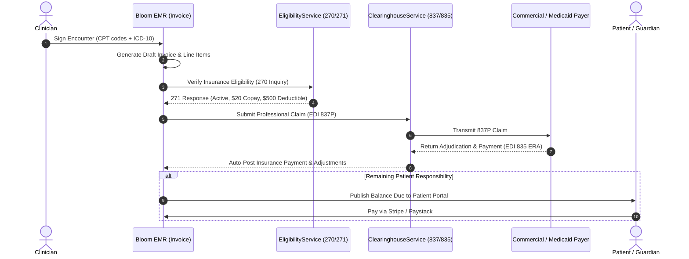

# Module 13: Revenue Cycle Management (RCM) & Billing

## 1. Executive Overview

The Revenue Cycle Management (RCM) & Billing module governs the complete financial lifecycle of patient care in Bloom EMR. Bridging clinical encounter documentation with insurance clearinghouses and consumer payment gateways, the module automates charge capture, ANSI X12 EDI claim transactions, remittance adjudication, and self-pay patient invoicing.

Key capabilities:
- **Automated Charge Capture**: Converts documented diagnoses (ICD-10) and CPT/E&M evaluation codes from signed encounters directly into itemized invoices.
- **Real-Time Eligibility Verification (EDI 270/271)**: Queries payer databases instantly via [EligibilityService](file:///c:/Users/User/Herd/bloom/app/Services/EligibilityService.php) to confirm active coverage, deductibles, and copay amounts.
- **Electronic Claim Submission (EDI 837P)**: Formats and transmits electronic professional claims to commercial insurers and Medicaid via [ClearinghouseService](file:///c:/Users/User/Herd/bloom/app/Services/ClearinghouseService.php).
- **Electronic Remittance Advice (EDI 835)**: Parses inbound payer adjudication files, auto-posts insurance payments, and identifies claim denial reason codes.
- **Multi-Gateway Patient Payments**: Integrated patient payment processing supporting Stripe (global credit/debit cards) and Paystack (regional card and bank transfers) via the Patient Portal and Front Desk POS.

---

## 2. Billing & Claims Lifecycle

---

## 3. Database Architecture & Schema

### 1. [Invoice](file:///c:/Users/User/Herd/bloom/app/Models/Invoice.php)
- **Table**: `invoices`
- **Traits**: [BelongsToPractice](file:///c:/Users/User/Herd/bloom/app/Models/Concerns/BelongsToPractice.php), `HasFactory`

| Column | Type | Description |
| :--- | :--- | :--- |
| `id` | `bigint unsigned` | Primary key |
| `practice_id` | `foreignId` | Associated practice tenant |
| `patient_id` | `foreignId` | Billed patient |
| `encounter_id` | `foreignId nullable` | Source encounter |
| `invoice_number`| `string` | Unique invoice code (e.g., `'INV-2026-00412'`) |
| `total_amount` | `decimal` | Total gross charges |
| `insurance_paid`| `decimal` | Amount paid by payer |
| `patient_paid` | `decimal` | Amount paid by patient |
| `balance_due` | `decimal` | Remaining outstanding balance |
| `status` | `string` | `draft`, `submitted`, `partially_paid`, `paid`, `denied`, `written_off` |
| `claim_id` | `string nullable` | External clearinghouse claim identifier |
| `claim_submitted_at`| `dateTime nullable` | 837P transmission timestamp |
| `claim_adjudicated_at`| `dateTime nullable`| 835 processing timestamp |
| `denial_reason` | `string nullable` | CARC/RARC denial reason code if rejected |

### 2. [Payment](file:///c:/Users/User/Herd/bloom/app/Models/Payment.php)
- **Table**: `payments`

| Column | Type | Description |
| :--- | :--- | :--- |
| `invoice_id` | `foreignId` | Associated invoice |
| `practice_id` | `foreignId` | Associated practice |
| `amount` | `decimal` | Payment amount |
| `method` | `string` | `credit_card`, `cash`, `check`, `stripe`, `paystack`, `insurance_era` |
| `transaction_reference`| `string` | Gateway charge ID (e.g., `'ch_3N1234...'`) |
| `status` | `string` | `completed`, `refunded`, `failed` |

### 3. [EligibilityCheck](file:///c:/Users/User/Herd/bloom/app/Models/EligibilityCheck.php)
- **Table**: `eligibility_checks`
- Records 270/271 request-response payloads, copay amounts, deductible balances, and coverage status (`active`, `inactive`).

---

## 4. Integration Services

### 1. [ClearinghouseService](file:///c:/Users/User/Herd/bloom/app/Services/ClearinghouseService.php)
- Interfaces with national clearinghouses (Avality, Change Healthcare).
- Generates compliant ANSI X12 837P electronic files.
- Ingests ANSI X12 835 Electronic Remittance Advice (ERA) files and parses Claim Adjustment Reason Codes (CARC).
- Features sandbox mock drivers (`mockSubmitClaim`) for testing without clearinghouse enrollment fees.

### 2. [EligibilityService](file:///c:/Users/User/Herd/bloom/app/Services/EligibilityService.php)
- Submits real-time 270 electronic inquiries and parses 271 responses into normalized insurance metadata.

### 3. Payment Gateways: [StripePaymentService](file:///c:/Users/User/Herd/bloom/app/Services/StripePaymentService.php) & [PaystackPaymentService](file:///c:/Users/User/Herd/bloom/app/Services/PaystackPaymentService.php)
- Encapsulates credit/debit card tokenization, webhooks, and automatic receipt generation.

---

## 5. UI Components & Layouts

- [BillingManager](file:///c:/Users/User/Herd/bloom/app/Livewire/Billing/BillingManager.php):
  - Invoicing dashboard for clinic billing admins.
  - Generates patient invoices, applies manual adjustments, and records front-desk cash/card collections.
- [ClaimsCenter](file:///c:/Users/User/Herd/bloom/app/Livewire/Billing/ClaimsCenter.php):
  - Centralized clearinghouse workstation.
  - Displays claims categorized by status: `Ready to Submit`, `In Clearinghouse`, `Adjudicated`, `Denied`.
  - One-click batch submission of clean claims.
- [ClaimManager](file:///c:/Users/User/Herd/bloom/app/Livewire/Billing/ClaimManager.php):
  - In-depth inspection of a specific claim, including CPT modifiers, diagnostic pointers, and ERA denial resolution workflows.
- [PortalBilling](file:///c:/Users/User/Herd/bloom/app/Livewire/Portal/PortalBilling.php):
  - Patient portal statement view where patients and guardians review itemized invoices and pay outstanding balances securely online.

---

## 6. Testing & Quality Assurance

- [BillingTest](file:///c:/Users/User/Herd/bloom/tests/Feature/BillingTest.php):
  - Tests invoice generation, line item calculations, and balance balance updates.
- [InsuranceClaimsTest](file:///c:/Users/User/Herd/bloom/tests/Feature/InsuranceClaimsTest.php):
  - Validates 837 claim construction and clearinghouse submission responses.
- [AdvancedBillingTest](file:///c:/Users/User/Herd/bloom/tests/Feature/AdvancedBillingTest.php):
  - Tests partial payments, secondary insurance billing, and ERA adjustment posting.
