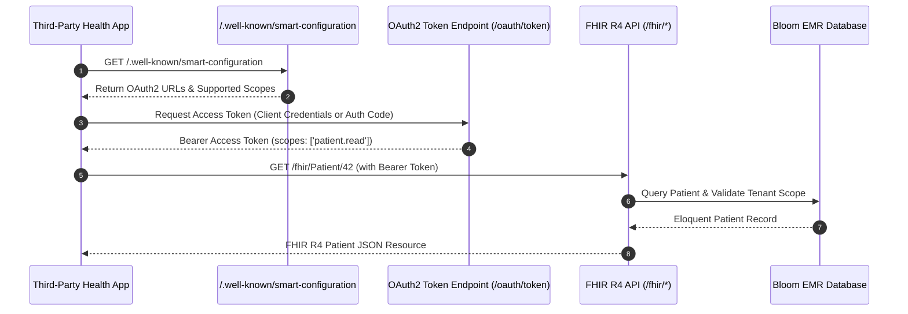

# Module 14: Interoperability, SMART on FHIR & Health Standards

## 1. Executive Overview

The Interoperability & Health Standards module transforms Bloom EMR into an open, connected health platform. Conforming to the 21st Century Cures Act and ONC certification mandates, Bloom implements a complete HL7 FHIR R4 (Fast Healthcare Interoperability Resources) server, SMART on FHIR authorization protocols via OAuth2, Direct Trust encrypted provider-to-provider messaging, Health Information Exchange (HIE) connectors, and an automated event-driven webhook engine.

Key capabilities:
- **SMART on FHIR R4 REST API**: Native JSON endpoints supporting clinical read, write, and search capabilities for external health apps and patient portals.
- **OAuth2 Token Authority (Laravel Passport)**: Granular scope-based access tokens (`patient.read`, `patient.write`) governing external client connections.
- **Direct Trust Protocol**: Encrypted SMTP/S-MIME provider-to-provider health information exchange via [DirectMessagingService](file:///c:/Users/User/Herd/bloom/app/Services/DirectMessagingService.php).
- **Health Information Exchange (HIE)**: Bi-directional demographic and clinical document query/retrieve transactions with regional health networks via [HieIntegrationService](file:///c:/Users/User/Herd/bloom/app/Services/HieIntegrationService.php).
- **Event Webhooks**: Outbound HTTP webhooks notifying external systems upon encounter signing, lab reporting, or patient registration via [WebhookDispatcherService](file:///c:/Users/User/Herd/bloom/app/Services/WebhookDispatcherService.php).

---

## 2. SMART on FHIR Architecture

---

## 3. Endpoints & Route Specifications

Configured in [routes/api.php](file:///c:/Users/User/Herd/bloom/routes/api.php):

### 1. Discovery & Metadata (Public)
- `GET /.well-known/smart-configuration`: Returns discovery metadata conforming to the SMART App Launch specification.
- `GET /fhir/metadata`: Returns the FHIR `CapabilityStatement` declaring supported resource types, search parameters, and interaction modes.

### 2. Clinical Resources (`scopes:patient.read`)
- `GET /fhir/Patient`: Search patients by identifier, name, or birthdate.
- `GET /fhir/Patient/{patient}`: Read individual patient FHIR resource.
- `GET /fhir/Encounter`: Search encounters by patient, date, or class.
- `GET /fhir/Observation`: Search clinical observations (vitals, lab results) mapped to LOINC/SNOMED.
- `GET /fhir/MedicationRequest`: Retrieve outpatient and inpatient prescriptions mapped to RxNorm.
- `GET /fhir/DocumentReference`: Retrieve clinical notes and attached medical documents.

### 3. Clinical Write Operations (`scopes:patient.write`)
- `POST /fhir/Patient` / `PUT /fhir/Patient/{patient}`: Ingest or update patient demographics from external systems.
- `POST /fhir/Encounter` / `PUT /fhir/Encounter/{encounter}`: Record or update encounter details.

### 4. Event Subscriptions (`scopes:patient.write`)
- `POST /fhir/Subscription`: Register a webhook callback URL for specific resource topic events (e.g., `'Encounter?status=signed'`).
- `DELETE /fhir/Subscription/{subscription}`: De-register active event subscriptions.

---

## 4. Code Systems & Mappings: [FhirCodeSystem](file:///c:/Users/User/Herd/bloom/app/Services/FhirCodeSystem.php)

The interoperability layer maps internal database records to internationally recognized healthcare terminology systems:
- **SNOMED CT**: Problem lists, surgical history, and anatomical findings (`http://snomed.info/sct`).
- **LOINC**: Laboratory observations, scored assessments (PHQ-9: `44249-1`), and vital sign panels (`http://loinc.org`).
- **RxNorm**: Medications and active ingredients (`http://www.nlm.nih.gov/research/umls/rxnorm`).
- **ICD-10-CM**: Encounter diagnoses and billing justification (`http://hl7.org/fhir/sid/icd-10-cm`).
- **CPT**: Evaluation, management, and procedural billing codes.

---

## 5. Direct Trust & HIE Services

### 1. [DirectMessagingService](file:///c:/Users/User/Herd/bloom/app/Services/DirectMessagingService.php)
- Implements EMR Direct phiMail protocol for secure, encrypted clinical messaging between verified provider NPI addresses.
- Packages Continuity of Care Documents (CCD / C-CDA XML) as encrypted attachments.

### 2. [HieIntegrationService](file:///c:/Users/User/Herd/bloom/app/Services/HieIntegrationService.php)
- Handles IHE XDS.b (Cross-Enterprise Document Sharing) profiles.
- Submits patient encounter summaries to regional Health Information Exchanges upon discharge.

---

## 6. Testing & Quality Assurance

- [FhirApiTest](file:///c:/Users/User/Herd/bloom/tests/Feature/FhirApiTest.php):
  - 17 automated tests verifying capability statements, smart-configuration discovery, token issuance, resource serialization, and FHIR schema validity.
  - Asserts that missing or invalid OAuth2 scopes return `403 Forbidden`.
  - Asserts strict tenant isolation across FHIR API queries.
- [IntegrationServicesTest](file:///c:/Users/User/Herd/bloom/tests/Feature/IntegrationServicesTest.php):
  - Tests Direct messaging encryption and HIE transaction payload generation.
