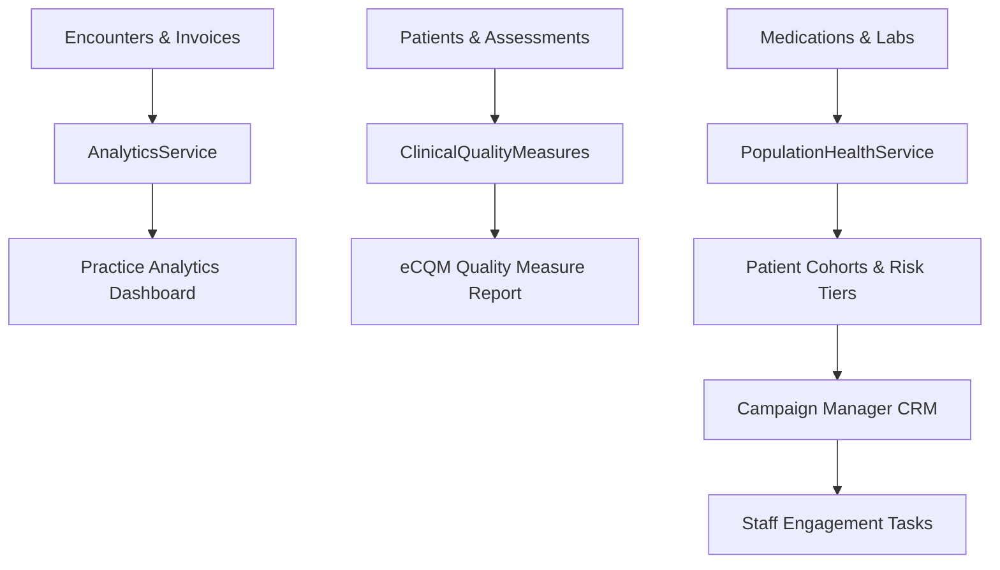

# Module 15: Analytics, Population Health & Operations

## 1. Executive Overview

The Analytics, Population Health & Operations module provides clinical leadership and operational staff with data intelligence, quality reporting, automated patient outreach, and daily clinic collaboration tools. It unites macro-level executive dashboards and electronic Clinical Quality Measures (eCQMs) with patient cohort risk stratification and staff productivity utilities (task managers, scratchpads, and internal messaging).

Key capabilities:
- **Practice Analytics & KPIs**: Real-time dashboards monitoring clinician encounter utilization, patient demographics, monthly encounter trends, and gross/net revenue collections.
- **Electronic Clinical Quality Measures (eCQMs)**: Automated, rule-based calculation of CMS quality reporting metrics (e.g., CMS2v11 Depression Screening, CMS68v11 Medication Documentation).
- **Population Health & Risk Stratification**: Dynamic cohort builder segmenting patient populations by age, chronic diagnoses, medication regimens, and risk tiers.
- **Patient Engagement & Outreach CRM**: Automated campaign engine creating targeted outreach tasks (SMS, email, phone call) based on active clinical criteria.
- **Staff Collaboration Utilities**: Integrated task boards with due-date alerts, shared workspace notes, staff direct messaging, vendor contract directories, and an integrated help center.

---

## 2. Architecture & Data Aggregation

---

## 3. Database Architecture & Schema

### 1. [PatientCohort](file:///c:/Users/User/Herd/bloom/app/Models/PatientCohort.php) & [PatientCohortMember](file:///c:/Users/User/Herd/bloom/app/Models/PatientCohortMember.php)
- **Tables**: `patient_cohorts`, `patient_cohort_members`
- Defines dynamic patient groups based on filter criteria (e.g., `'Diabetic Patients without HbA1c in 6 months'`).
- Tracks enrollment dates, risk tiers (`low`, `moderate`, `high`), and attributed providers.

### 2. [PatientEngagement](file:///c:/Users/User/Herd/bloom/app/Models/PatientEngagement.php)
- **Table**: `patient_engagements`
- Tracks outreach interactions (campaigns, recall letters, follow-up calls).
- Fields: `patient_id`, `assigned_to`, `title`, `type` (`email`, `sms`, `call`, `letter`), `status` (`pending`, `completed`), `due_date`.

### 3. Operational Models
- [Task](file:///c:/Users/User/Herd/bloom/app/Models/Task.php): Internal staff to-do items linked to patients or general practice operations, with priority levels, assignees, and due dates.
- [WorkspaceNote](file:///c:/Users/User/Herd/bloom/app/Models/WorkspaceNote.php): Persistent personal and shared scratchpad notes rendered in the workspace auxiliary drawer.
- [DirectMessage](file:///c:/Users/User/Herd/bloom/app/Models/DirectMessage.php): Internal peer-to-peer staff communication.
- [Vendor](file:///c:/Users/User/Herd/bloom/app/Models/Vendor.php): Directory of external suppliers, medical equipment servicers, and pharmaceutical vendors.

---

## 4. Backend Services

### 1. [AnalyticsService](file:///c:/Users/User/Herd/bloom/app/Services/AnalyticsService.php)
- `clinicianUtilization(int $practiceId, int $month, int $year)`: Aggregates encounter volume per clinician, broken down by specialty role.
- `demographicBreakdown(int $practiceId)`: Groups active patients by gender identity, race/ethnicity, and standard epidemiological age brackets (0–17, 18–34, 35–49, 50–64, 65+).
- `monthlyEncounterTrend(int $practiceId)`: 12-month trailing encounter volume trend line.
- `revenueSummary(int $practiceId)`: Financial reconciliation of billed charges, insurance payments, and patient self-pay collections.

### 2. [PopulationHealthService](file:///c:/Users/User/Herd/bloom/app/Services/PopulationHealthService.php)
- Calculates population-level risk scores based on disease burden (Charlson Comorbidity index approximations).
- Scans for care compliance gaps and flags high-risk patients requiring case management intervention.

---

## 5. UI Components & Layouts

### 1. [PracticeAnalytics](file:///c:/Users/User/Herd/bloom/app/Livewire/PracticeAnalytics.php)
- Executive analytics dashboard featuring interactive month/year filters.
- Visual charts and metric summary cards for clinic administrators.

### 2. [ClinicalQualityMeasures](file:///c:/Users/User/Herd/bloom/app/Livewire/Reporting/ClinicalQualityMeasures.php)
- Formats eCQM compliance rates in CMS regulatory style:
  - **CMS2v11**: Percentage of patients aged 12+ screened for depression using validated tools (PHQ-9).
  - **CMS68v11**: Percentage of visits where current medications were verified and documented.
  - Displays target thresholds, current practice percentage, and numerator/denominator breakdowns.

### 3. [PopulationHealth](file:///c:/Users/User/Herd/bloom/app/Livewire/PopulationHealth.php)
- Cohort builder allowing staff to filter patients by complex criteria.
- One-click export of cohort rosters for community health workers.

### 4. [CampaignManager](file:///c:/Users/User/Herd/bloom/app/Livewire/Crm/CampaignManager.php)
- Enrolls filtered cohorts into multi-channel clinical outreach campaigns.
- Auto-generates patient engagement queues assigned to clinical support staff.

### 5. Staff Collaboration Workspaces
- [TaskList](file:///c:/Users/User/Herd/bloom/app/Livewire/Tasks/TaskList.php): Filterable kanban/list of clinical and administrative to-dos.
- [MessageCenter](file:///c:/Users/User/Herd/bloom/app/Livewire/MessageCenter.php): Real-time chat interface for clinic staff.
- [VendorList](file:///c:/Users/User/Herd/bloom/app/Livewire/Vendors/VendorList.php): Directory of practice suppliers and contacts.
- [HelpCenter](file:///c:/Users/User/Herd/bloom/app/Livewire/Workspace/HelpCenter.php): Integrated user manual and clinical workflow guidance.

---

## 6. Testing & Quality Assurance

- [DashboardReportingTest](file:///c:/Users/User/Herd/bloom/tests/Feature/DashboardReportingTest.php):
  - Tests clinician utilization query speed and demographic calculation accuracy.
  - Verifies eCQM numerator/denominator logic against database test fixtures.
- [PracticeOperationsTest](file:///c:/Users/User/Herd/bloom/tests/Feature/PracticeOperationsTest.php):
  - Tests task assignment, status updates, and workspace notes persistence.
- [PatientEngagementTest](file:///c:/Users/User/Herd/bloom/tests/Feature/PatientEngagementTest.php):
  - Tests campaign enrollment queries and task generation.
